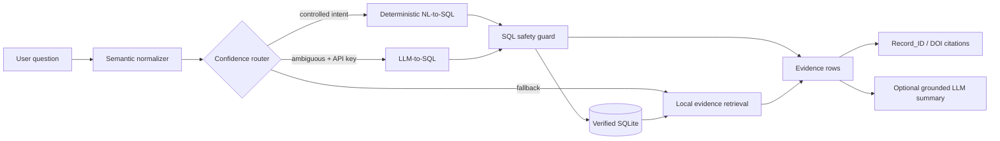

# Architecture

## Design principles

1. **Evidence first.** Answers are grounded in verified records.
2. **Semantic normalization before generation.** Known domain synonyms and distinctions are resolved before routing.
3. **LLM is not an access-control layer.** Generated SQL must pass a local guard before SQLite execution.
4. **Compatibility is preserved.** Units and measurement bases are not silently mixed.
5. **Local-first.** Deterministic querying and retrieval work without an API key.
